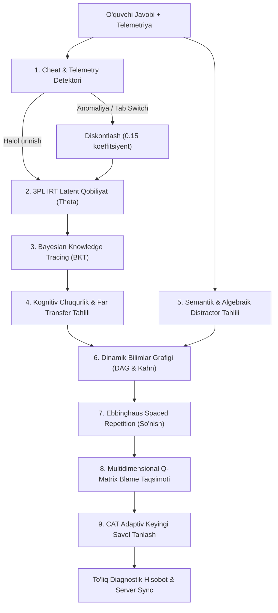

# 🔒⚠️ DIQQAT — BU LOYIHA OPEN SOURCE EMAS

> ## ⛔ RUXSATSIZ FOYDALANISH QAT’IYAN TAQIQLANADI
> **Repository’ni ko‘rish, clone yoki fork qilish sizga koddan foydalanish huquqini bermaydi.** Muallif/repository egasining **OLDINDAN YOZMA RUXSATISIZ** original kod, algoritm, arxitektura, hujjat va assetlarni nusxalash, o‘zgartirish, tarqatish, build/run/deploy qilish, tijoriy yoki notijoriy mahsulotda ishlatish, sotish/sublicense qilish yoki AI/ML training/dataset uchun ishlatish **TAQIQLANADI**.
>
> **Public preview faqat ko‘rib chiqish va baholash uchun.** Production/tijoriy foydalanish uchun alohida yozma tijoriy litsenziya kerak.
>
> 📄 **[TO‘LIQ LITSENZIYA — LICENSE.md](LICENSE.md)**  
> © 2026 AxionSoftware-Inc / repository owner — **BARCHA HUQUQLAR HIMOYALANGAN.**

---

# QuestLab — Keyingi Avlod Kognitiv Diagnostika va Adaptiv Ta'lim Platformasi

QuestLab — an'anaviy yuzaki test tizimlaridan farqli o'laroq, o'quvchining shunchaki to'g'ri yoki noto'g'ri javoblari sonini emas, balki uning **haqiqiy aqliy rentgen xaritasi**ni shakllantiruvchi ilg'or EdTech platformasi. Tizim zamonaviy psixometrika (Item Response Theory), ehtimollik nazariyasi (Bayesian Knowledge Tracing), kognitiv psixologiya (Bloom taksonomiyasi & Far Transfer) va graflar nazariyasi (DAG & Kahn topologiyasi) asosida ishlaydi.

---

## 🎯 Paradigma O'zgarishi: An'anaviy Testlar vs QuestLab

| Xususiyat | An'anaviy Test Platformalari | QuestLab Kognitiv Yadrosi |
| :--- | :--- | :--- |
| **Baholash asosi** | To'g'ri javoblar foizi ($X/Y \cdot 100\%$) | Latent qobiliyat ($\theta$) — 3PL IRT modeli |
| **Bilim chuqurligi** | Barcha to'g'ri javoblar teng baholanadi | Sayoz yodlash (Rote) vs Chuqur transfer ajratiladi |
| **Xato tahlili** | Faqat "Noto'g'ri" qizil belgi | Xato sababi: ishora, arifmetika, shoshqaloqlik, konseptual bo'shliq |
| **O'quv yo'li** | Chiziqli (barcha uchun bir xil ro'yxat) | Dinamik yo'naltirilgan asiklik graf (DAG) va Kahn topologiyasi |
| **Xotira va takrorlash** | Vaqt o'tishi hisobga olinmaydi | Ebbinghaus eksponensial so'nish modeli orqali takrorlash |
| **Test davomiyligi** | Qat'iy 30–50 ta savol | CAT: $SE \le 0.35$ aniqlikka erishilganda 6–8 ta savolda to'xtatiladi |
| **Firibgarlik nazorati** | Faqat vaqt o'lchagich | Telemetriya: tab almashtirish, dwell time va guessing detektori |

---

## 🏗️ Tizim Arxitekturasi va Diagnostika Oqimi

Quyidagi diagrammada o'quvchi javob bergan paytdan boshlab hisobot shakllanguncha bo'lgan to'liq matematik tahlil quvuri (pipeline) keltirilgan:



---

## 🧠 12 ta Asosiy Matematik va Kognitiv Modul

### 1. 3PL Item Response Theory (IRT) & Bayes EAP
An'anaviy testlarda 1 ta qiyin savolni topgan o'quvchi bilan 1 ta oson savolni topgan o'quvchiga bir xil 1 ball beriladi. QuestLab'da har bir savol 3 ta psixometrik parametrga ega:
- $b_j$ — savolning haqiqiy qiyinligi (Difficulty)
- $a_j$ — diskriminatsiya (ajratish qobiliyati)
- $c_j$ — taxminan topish ehtimoli (Pseudo-guessing)

Qobiliyat $\theta$ bo'lganda to'g'ri javob berish ehtimoli:
$$P_j(\theta) = c_j + \frac{1 - c_j}{1 + \exp\big(-1.7 \cdot a_j \cdot (\theta - b_j)\big)}$$

O'quvchining latent qobiliyati $\hat{\theta}$ subyektiv emas, balki **Bayes EAP (Expected A Posteriori)** integrali orqali Gauss-Hermite kvadraturalari yordamida hisoblanadi:
$$\hat{\theta}_{\text{EAP}} = \frac{\int_{-\infty}^{+\infty} \theta \cdot L(\mathbf{u} | \theta) \cdot \pi(\theta) \, d\theta}{\int_{-\infty}^{+\infty} L(\mathbf{u} | \theta) \cdot \pi(\theta) \, d\theta}$$

O'lchov aniqligi **Fisher Axborot Funksiyasi** va **Standart Xatolik ($SE$)** orqali baholanadi:
$$I_j(\theta) = \frac{(P'_j(\theta))^2}{P_j(\theta)(1 - P_j(\theta))}, \quad SE(\hat{\theta}) = \frac{1}{\sqrt{\sum_{j} I_j(\hat{\theta})}}$$

### 2. Bayesian Knowledge Tracing (BKT)
Har bir mavzu bo'yicha o'quvchining bilim holati $P(L_t) \in [0, 1]$ dinamik ehtimollik bilan ifodalanadi.
- **Kuzatishdan keyingi yangilanish:**
  $$P(L_t \mid \text{to'g'ri}) = \frac{P(L_t) \cdot (1 - P(S))}{P(L_t) \cdot (1 - P(S)) + (1 - P(L_t)) \cdot P(G)}$$
  $$P(L_t \mid \text{noto'g'ri}) = \frac{P(L_t) \cdot P(S)}{P(L_t) \cdot P(S) + (1 - P(L_t)) \cdot (1 - P(G))}$$
- **Keyingi qadamga o'tish (O'rganish tranzitsiyasi):**
  $$P(L_{t+1}) = P(L_t \mid \text{obs}) + (1 - P(L_t \mid \text{obs})) \cdot P(T)$$
Bu yerda $P(G)$ — bilmay turib taxminan topish (Guess), $P(S)$ — bilib turib adashish (Slip), $P(T)$ — o'rganish ehtimoli (Transition). Savol formatiga qarab (masalan, qisqa yozma javobda $P(G) = 0.05$, 4 variantli testda $P(G) = 0.25$) parametrlar moslashadi.

### 3. Kognitiv Chuqurlik, Entropiya va Far Transfer (Sayoz vs Chuqur)
Agar o'quvchi bir xil shablondagi 5 ta oson misolni yodlab olib to'g'ri topsa, an'anaviy tizimlar unga 100% ball beradi. QuestLab esa kognitiv soxtalikni fosh etadi:
- **Jaccard Matn O'xshashlik Entropiyasi ($H_{\text{diversity}}$):** Savollar matni n-gramm darajasida qiyoslanadi. Agar savollar bir-biriga juda o'xshash bo'lsa, xilma-xillik past deb baholanadi.
- **Bloom Gradienti ($\beta$):** Kognitiv darajalar (Eslab qolish $\to$ Jarayon $\to$ Konseptual $\to$ Analitik) bo'yicha to'g'rilik regressiyasi hisoblanadi.
- **Far Transfer Indeksi ($T$):** Nostandart, hayotiy va kontekstli masalalardagi natija standart masalalar natijasiga nisbatan o'lchanadi.
- **Xulosa:** Agar $\beta < -0.30$ yoki $T < 0.40$ bo'lsa $\to$ **`isRoteMemorized: true` (Sayoz yodlash)** belgilanadi va chuqur tushunish bo'yicha qo'shimcha topshiriqlar tavsiya etiladi.

### 4. Algebraik va Semantik Distractor Tahlili ("Nega adashdi?")
O'quvchi tanlagan noto'g'ri variant va to'g'ri javob o'rtasidagi matematik farq tahlil qilinadi:
- `sign_error`: Tenglikdan o'tkazishda ishora adashtirilgan ($s = -c$).
- `calculation_error`: Kichik arifmetik xatolik ($|s - c| \le 2$).
- `unit_error`: Vergul yoki razryad siljishi (10, 100 yoki 1000 karra farq).
- `reading_error`: Ajratilgan vaqtdan 3 barobar tez belgilangan shoshqaloqlik.
- `formula_misuse`: Qisqa ko'paytirish, diskriminant yoki qavs ochish formulasining noto'g'ri qo'llanilishi.
- `concept_gap`: Fundamental konseptual tushunmovchilik.
Har bir xato turiga mos ravishda o'quvchiga **Diagnostik tushuntirish** va **Aniq tuzatish tavsiyasi** beriladi.

### 5. Universal Dinamik Graf (DAG) va Kahn Topologik Tartiblash
Fan mavzulari statik ro'yxat emas, balki dinamik yo'naltirilgan asiklik grafdir (DAG).
- **Kahn Algoritmi ($O(V + E)$):** Mavzular orasidagi bog'liqliklarni (prerequisites) tahlil qilib, o'rganishning eng optimal zanjirini tuzadi.
- **Hub Centrality:** Qaysi mavzu keyingi eng ko'p mavzularga eshik ochuvchi poydevor ekanligini hisoblaydi.
- **Root Cause Finder:** Qiyin mavzuda yiqilgan o'quvchining grafdagi barcha ajdodlarini tekshirib, muammoning eng tubidagi zaif poydevorni aniqlaydi.

### 6. Spaced Repetition (Ebbinghaus Forgetting Curve)
Inson xotirasida bilim vaqt o'tishi bilan eksponensial so'nadi:
$$R(t) = \exp\left(-\frac{\Delta t}{S}\right)$$
bu yerda $\Delta t$ — oxirgi mashg'ulotdan o'tgan vaqt (kun), $S$ — xotira barqarorligi (qobiliyat $\theta$ va muvaffaqiyatga bog'liq). Agar $R(t) < 0.60$ ga tushsa, mavzu `decayed` deb belgilanadi va takrorlash rejasi tuziladi.

### 7. Telemetriya va Ko'chirish Detektori (Anti-Cheat)
O'quvchining xatti-harakatlari telemetriya datchiklari orqali kuzatiladi:
- Oynadan tashqariga chiqish (`tabSwitchCount`), tashqarida turish vaqti (`outOfWindowDurationSeconds`) va javobni tinimsiz almashtirish (`changedCount`).
- Agar o'quvchi oyna almashtirib, internetdan qidirib kelib to'g'ri belgilagan bo'lsa (`suspected_lookup`), ushbu javob IRT va BKT hisob-kitoblarida 85% ga diskontlanadi ($w = 0.15$), profilga soxta ball o'tishi to'siladi.

### 8. Kompyuterlashgan Adaptiv Test (CAT) Real-time Engine
Har bir savoldan so'ng o'quvchining joriy $\hat{\theta}$ darajasida maksimal axborot beruvchi savol saralanadi:
$$q^* = \arg\max_{q \in \text{Bank}} I_q(\hat{\theta})$$
O'lchov aniqligi $SE(\hat{\theta}) \le 0.35$ ga yetishi bilan test **6–8 ta savolda** erta to'xtatiladi. O'quvchi 30 ta keraksiz savol yechib charchamaydi.

### 9. Savollar Bankining O'zini Kalibrlashi (Self-Calibration)
Har bir savolning empirik qiyinligi ($p$-value) va Point-Biserial korrelyatsiyasi ($r_{\text{pbis}}$) hisoblab boriladi:
$$r_{\text{pbis}} = \frac{\bar{X}_1 - \bar{X}}{\sigma_X} \sqrt{p(1 - p)}$$
Agar $r_{\text{pbis}} < 0$ bo'lsa (ya'ni a'lochi o'quvchilar bu savolda ko'proq adashgan bo'lsa), tizim savolga **`flawed_question`** tamg'asini bosadi va o'qituvchiga ogohlantirish beradi.

### 10. Cold-Start Placement Blitz
Yangi foydalanuvchini platformaga kirishi bilan uzoq testlarga solmasdan, atigi **5 ta binar savol** orqali uning boshlang'ich $\theta_0$ latent qobiliyatini va darajasini (`beginner`, `intermediate`, `advanced`) aniqlaydi.

### 11. Multidimensional Q-Matrix Credit & Blame Assignment
Bir nechta ko'nikmani talab qiluvchi murakkab savollarda xato qilinganda, ayb hamma ko'nikmalarga teng taqsimlanmaydi. Bayesian Blame orqali o'quvchining profildagi eng zaif ko'nikmasiga ko'proq xato yoziladi va o'sha ko'nikma mashqqa yo'naltiriladi.

### 12. Doimiy Saqlash va Server Sinxronizatsiyasi
Barcha hisoblangan IRT parametrlari, BKT ehtimolliklari, xato sabablari va o'quv traektoriyasi mahalliy keshda saqlanadi hamda Django REST API (`/api/mastery/sync/`) bilan avtomatik sinxronlashadi.

---

## 📂 Loyiha Tuzilishi (Codebase Architecture)

```
d:/Web-Test/
├── src/
│   ├── features/
│   │   ├── mastery-engine/          # 🧠 Kognitiv Diagnostika Yadrosi
│   │   │   ├── model/
│   │   │   │   ├── irt.ts           # 3PL IRT, Fisher Information & Bayes EAP
│   │   │   │   ├── bkt.ts           # Bayesian Knowledge Tracing
│   │   │   │   ├── depth-analyzer.ts# Bloom Gradient, Far Transfer & Rote Detection
│   │   │   │   ├── distractor-analyzer.ts # Semantik & Algebraik xato tashxisi
│   │   │   │   ├── topic-graph.ts   # Universal Dinamik Graf & Kahn algoritmi
│   │   │   │   ├── decay-engine.ts  # Ebbinghaus eksponensial so'nish modeli
│   │   │   │   ├── telemetry-cheat-detector.ts # Tab switch & Cheat detektori
│   │   │   │   ├── cat-engine.ts    # Kompyuterlashgan Adaptiv Test yadrosi
│   │   │   │   ├── item-calibration.ts # Point-Biserial & Savol sifati tahlili
│   │   │   │   ├── placement-blitz.ts  # 5 savolli tezkor daraja aniqlovchi
│   │   │   │   ├── multidimensional-tracing.ts # Q-matrix Blame taqsimoti
│   │   │   │   ├── learning-path.ts # Ta'lim chegarasi & blokatorlar
│   │   │   │   ├── scoring.ts       # Centrality & Uncertainty ustuvorlik balli
│   │   │   │   ├── mastery-persistence.ts # Kesh va Server Sync payload
│   │   │   │   ├── mastery-engine.ts# Birlashtiruvchi to'liq hisobot generatori
│   │   │   │   ├── types.ts         # Qat'iy TypeScript interfeyslari
│   │   │   │   └── index.ts         # Ommaviy eksportlar
│   │   ├── student/ui/
│   │   │   ├── student-diagnostics.tsx # Diagnostika & Rentgen UI vizualizatsiyasi
│   │   │   └── student-result.tsx      # Natijalar va tavsiyalar ekrani
├── tests/
│   ├── mastery-engine-advanced.test.mjs # 34 ta ilg'or matematik unit-test
│   ├── scoring.test.mjs                 # 5 ta javobni tekshirish testi
│   ├── module-registry.test.mjs         # 6 ta mikroyadro arxitektura testi
│   ├── import-parser.test.mjs           # 3 ta CSV/JSON import testi
│   └── auth-token.test.mjs              # 3 ta autentifikatsiya testi
├── docs/                                # Mahsulot va texnik hujjatlar
└── README.md                            # Ushbu hujjat
```

---

## 🚀 Ishga Tushirish va Tekshirish (Quick Start & Tests)

### Loyihani o'rnatish va ishga tushirish

```bash
# Kutubxonalarni o'rnatish
npm install

# Mahalliy serverni ishga tushirish
npm run dev
```

Brauzerda [http://localhost:3000](http://localhost:3000) manzilini oching.

### Testlar va Tizim Salomatligini Tekshirish

QuestLab kognitiv yadrosi to'liq avtomatlashtirilgan unit-testlar bilan qamrab olingan (51 ta test, 100% PASS):

```bash
# Barcha testlarni ishga tushirish
npm test

# TypeScript statik tahlilini tekshirish (0 errors)
npx tsc --noEmit

# Kod stilini tekshirish va build qilish
npm run lint
npm run build
```

---

## 📥 Savollar Bazasini Import Qilish Formati (Question Schema)

Yangi test savollarini platformaga kiritish uchun standart JSON shabloni:

```json
{
  "id": 1,
  "type": "multiple_choice",
  "title": "Kasrli tenglama",
  "body": "$\\frac{x}{4}=6$ tenglamani yeching.",
  "options": ["$x=10$", "$x=18$", "$x=24$", "$x=28$"],
  "answer": "$x=24$",
  "explanation": "$\\frac{x}{4}=6 \\Rightarrow x=6\\cdot4 \\Rightarrow x=24$.",
  "subject": "Algebra",
  "topic": "Kasrli tenglamalar",
  "topic_slug": "fraction-equations",
  "skills": ["fraction-equation", "multiplication-property"],
  "level": "beginner",
  "difficulty": "easy",
  "estimated_seconds": 25,
  "mastery_weight": 1,
  "is_fundamental": true,
  "prerequisites": ["linear-equations"],
  "mistake_tags": ["fraction-error", "transformation-error"],
  "remediation": {
    "practice_slug": "fraction-equations-practice",
    "lesson_slug": "fraction-equations-review"
  }
}
```

---

## 📄 Hujjatlar Mundarijasi

- [docs/project-overview.md](docs/project-overview.md) — Mahsulot missiyasi va yo'nalishi
- [docs/site-map.md](docs/site-map.md) — Platforma sahifalari va marshrutlari
- [docs/expansion-plan.md](docs/expansion-plan.md) — Rivojlanish va kengayish rejasi
- [docs/architecture-audit.md](docs/architecture-audit.md) — Arxitektura auditi
- [docs/api-reference.md](docs/api-reference.md) — API spetsifikatsiyalari
- [docs/schemas/test-pack-v1.schema.json](docs/schemas/test-pack-v1.schema.json) — JSON Schema